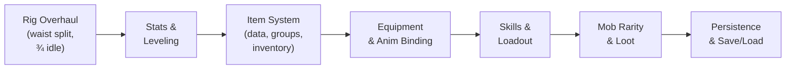

# Elemental Heir — Design Roadmap

> [!IMPORTANT]
> This document captures the full feature roadmap agreed upon on 2026-10-29.
> It supersedes the milestone stubs in `IMPLEMENTATION.md` (M5–M11) and should
> be the single source of truth for what to build next.

---

## 1. Character Rig Overhaul

### 1.1 Idle Pose: Sideward-Front View
- The default idle is **not** a pure side view. The character faces slightly
  toward the camera (¾ / sideward-front), so the chest and face are partially
  visible.
- All rig art, pivot JSON, and animation clips must be authored for this
  angled idle.

### 1.2 Waist / Leg Split
- The waist bone divides the torso from the legs.
- Each leg (`upper_leg_l`, `lower_leg_l`, `foot_l`, `upper_leg_r`,
  `lower_leg_r`, `foot_r`) is its own chain hanging off the waist.
- Walk / run cycles animate the two legs **independently** so they can stride
  out of phase.
- The rig must **not** be rigid — every joint uses smooth interpolation, and
  subtle secondary motion (cloth sway, hair bounce) is encouraged.

### 1.3 Walk Sprite (Monster)
- Add individual walk frames for the wolf mob later (user will supply the
  sprite sheet). `mob.gd` already checks for the `"walk"` animation name and
  will use it automatically.

---

## 2. Stats, Levels & Multipliers

### 2.1 Core Stats
Every character (player and enemy) resolves these stats at runtime:

| Stat | Description |
| --- | --- |
| `max_health` | Total hit points |
| `attack` | Base outgoing damage |
| `defence` | Reduces incoming damage |
| `move_speed` | Walk / run speed (px/s) |
| `crit_rate` | Chance to deal critical damage (0.0–1.0) |
| `crit_damage` | Critical-hit multiplier (e.g. 1.5×) |
| `cooldown_reduction` | Reduces skill cooldowns (0.0–1.0) |

### 2.2 Stat Pipeline
```
final_stat = (base + flat_bonus) × (1 + pct_bonus)
```

- **Base** comes from `CharacterData` / `EnemyData` at the entity's current
  level.
- **Flat bonus** comes from equipment, buffs, and passives.
- **Pct bonus** comes from equipment set bonuses, skill passives, and buffs.

### 2.3 Damage Formula
```
raw_damage  = attacker.attack × skill_multiplier
mitigation  = raw_damage × (defence / (defence + K))
final       = max(1, raw_damage - mitigation)
```
`K` is a tuning constant (start with `100`).

### 2.4 Leveling
- Level cap: **15** (from GDD).
- Each level grants flat stat growth defined per class in `CharacterData`:
  `hp_per_level`, `attack_per_level`, `defence_per_level`.
- XP curve: `xp_to_next(level) = base_xp × level ^ exponent` (tuneable in a
  global resource).
- Enemies yield XP defined in `EnemyData.xp_reward`.

### 2.5 `Stats` Component
A new `Stats` node (child of the entity, like `Health`):

```
Stats.configure(base_data, level)
Stats.add_modifier(source_id, stat, flat, pct)
Stats.remove_modifier(source_id)
Stats.get(stat) -> float
signal stats_changed
```

`Character.take_damage()` and `Hitbox` read from `Stats` instead of raw
`CharacterData` fields.

---

## 3. Item System

### 3.1 Item Groups / Types

Items are classified into **groups** and **types** so that animations,
equip-slot validation, and class restrictions are all driven by data.

#### Weapon Groups

| Group | Slot | Examples | Classes |
| --- | --- | --- | --- |
| `heavy_sword` | primary | Greatsword, Claymore | Warrior |
| `sword` | primary | Longsword, Short Sword | Warrior |
| `shield` | secondary | Buckler, Tower Shield | Warrior |
| `staff` | primary | Flame Staff, Frost Rod | Mage |
| `orb` | secondary | Crystal Orb, Grimoire | Mage |
| `dagger` | primary | Stiletto, Kris | Assassin |
| `off_hand` | secondary | Parrying Dagger, Claw | Assassin |

#### Armour Groups

| Group | Slot |
| --- | --- |
| `helmet` | head |
| `chest_armour` | chest |
| `pants` | pants |
| `boots` | boots |

#### Accessory Groups

| Group | Slot |
| --- | --- |
| `necklace` | necklace |
| `ring` | ring |

#### Consumable Groups

| Group | Notes |
| --- | --- |
| `potion` | Heal / buff, stackable |
| `material` | Evolution / crafting ingredient |

### 3.2 Equipment Slots

```
head, chest, pants, boots, necklace, ring, primary, secondary
```

> [!NOTE]
> The old M9 had `foot` and `necklace` plus `primary/secondary`. We now add
> `ring` as a second accessory slot and rename `foot` → `boots` for clarity.

### 3.3 Hand & Attack Animation Binding

- Each **weapon group** defines a `weapon_anim_set: StringName` (e.g.
  `"heavy_sword"`, `"dagger"`).
- `CharacterAnimations` (the builder interface) looks up the equipped weapon
  group and selects the matching attack combo clips, idle hand pose, and
  walk arm swing.
- Swapping from a sword to a staff at runtime rebuilds only the affected
  animation tracks (arms + weapon bone).

### 3.4 `ItemData` Resource

```gdscript
class_name ItemData extends Resource

enum ItemType { WEAPON, ARMOUR, ACCESSORY, CONSUMABLE, MATERIAL }
enum Rarity   { COMMON, UNCOMMON, RARE, EPIC, LEGENDARY }

@export var id: StringName
@export var display_name: String
@export var item_type: ItemType
@export var item_group: StringName          # "heavy_sword", "helmet", "potion"…
@export var rarity: Rarity
@export var icon: Texture2D
@export var max_stack: int = 1              # >1 for consumables / materials
@export var class_restriction: Array[CharacterData.CharacterRole] = []
@export var description: String
```

### 3.5 `EquipmentData` (extends `ItemData`)

```gdscript
class_name EquipmentData extends ItemData

@export var equip_slot: StringName          # "primary", "head", "ring"…
@export var stat_modifiers: Array[StatModifier] = []
@export var granted_skill: SkillData        # optional on-equip skill
@export var weapon_anim_set: StringName     # for weapons only
```

### 3.6 Inventory

- Fixed-size bag (e.g. 30 slots).
- Each slot: `{ item: ItemData, count: int }`.
- Operations: `add_item`, `remove_item`, `swap_slots`, `split_stack`,
  `sort_by_type`.
- UI: grid with drag-and-drop or tap-to-move, filter tabs per `ItemType`.

### 3.7 Equipment Manager

- Validates `equip_slot`, `class_restriction`, and weapon-group rules before
  equipping.
- On equip/unequip, pushes `stat_modifiers` into `Stats` and triggers
  `stats_changed`.
- Weapon equip triggers an animation-set rebuild.

---

## 4. Skills

### 4.1 `SkillData` Resource

```gdscript
class_name SkillData extends Resource

enum SkillType   { ACTIVE, PASSIVE, ULTIMATE }
enum DamageType  { PHYSICAL, FIRE, WATER, WIND, EARTH, SHADOW }

@export var id: StringName
@export var display_name: String
@export var skill_type: SkillType
@export var damage_type: DamageType
@export var class_restriction: Array[CharacterData.CharacterRole] = []
@export var unlock_level: int = 1
@export var cooldown: float = 5.0
@export var resource_cost: int = 0          # mana / stamina
@export var damage_multiplier: float = 1.5  # of attack stat
@export var hit_window: Vector2 = Vector2(0.3, 0.65)
@export var animation_id: StringName        # clip bundled with the skill
@export var icon: Texture2D
@export var description: String
```

### 4.2 Skill Loadout
- Slots: **3 active + 1 ultimate**.
- APIs: `unlock_skill(id)`, `equip_skill(id, slot)`, `unequip_skill(slot)`,
  `use_skill(slot)`.
- Cooldowns tracked per slot; UI shows radial sweep.

### 4.3 Skill Animations
- Each skill ships with its own animation clip (`animation_id`).
- The clip is added to the `AnimationLibrary` when the skill is equipped.
- Melee skills reuse `Hitbox`; ranged/projectile skills spawn a projectile
  scene referenced in the skill data.
- The animation defines arm, weapon, and VFX tracks — it is **bundled** with
  the skill, not with the weapon.

---

## 5. Mob Rarity & Types

### 5.1 Rarity Tiers

| Rarity | Stat Multiplier | Loot Bonus | Visual Cue |
| --- | --- | --- | --- |
| **Normal** | ×1.0 | — | No outline |
| **Epic** | ×1.5 | Better drops | Purple outline/glow |
| **Legendary** | ×2.5 | Rare drops | Gold outline/glow |
| **Anomaly** | ×4.0 | Unique drops | Red/black aura, screen-shake on spawn |

### 5.2 Boss Variant: Normal (Boss)
- A boss is a **Normal-rarity** enemy with a unique `EnemyData` that has
  higher base stats, a larger sprite, and special attack patterns.
- Flagged by `EnemyData.is_boss: bool` — this gates the boss health bar UI
  (full-width bar at the screen bottom) and the loot table.

### 5.3 `EnemyData` Extension

```gdscript
# Add to existing EnemyData
@export var rarity: int = 0                  # 0=Normal, 1=Epic, 2=Legendary, 3=Anomaly
@export var is_boss: bool = false
@export var xp_reward: int = 10
@export var loot_table: Array[LootEntry] = []

# Rarity stat multipliers applied at runtime:
const RARITY_MULTIPLIER := [1.0, 1.5, 2.5, 4.0]
```

### 5.4 `LootEntry`

```gdscript
class_name LootEntry extends Resource
@export var item: ItemData
@export var weight: float = 1.0
@export var min_count: int = 1
@export var max_count: int = 1
```

---

## 6. Implementation Order



| Phase | Maps to | Key deliverables |
| --- | --- | --- |
| **Phase 1** | Rig overhaul | ¾ idle pose, waist/leg split, smooth walk |
| **Phase 2** | Stats & Leveling | `Stats` component, damage formula, XP/level-up |
| **Phase 3** | Items | `ItemData`, `EquipmentData`, inventory grid, equip slots |
| **Phase 4** | Equipment binding | Weapon-group anim sets, stat recompute on equip |
| **Phase 5** | Skills | `SkillData`, loadout, cooldowns, bundled animations |
| **Phase 6** | Mob rarity & loot | Rarity tiers, boss flag, drop tables, loot pickup |
| **Phase 7** | Persistence | Save/load all character state, data validation |

---

## 7. File Layout (Planned)

```
resources/
  characters/
    character_data.gd
    warrior.tres
    mage.tres
    assassin.tres
  entities/
    enemy_data.gd
    goblin.tres
    wolf.tres
  items/
    item_data.gd
    equipment_data.gd
    loot_entry.gd
    weapons/          # .tres per weapon
    armour/           # .tres per armour piece
    accessories/      # .tres per accessory
    consumables/      # .tres per potion/material
  skills/
    skill_data.gd
    warrior/          # .tres per warrior skill
    mage/
    assassin/
scripts/
  characters/
    character.gd
    character_rig.gd
    character_animations.gd   # interface
    warrior_side_animations.gd
  combat/
    health.gd
    hitbox.gd
    stats.gd
    damage.gd          # damage formula
  inventory/
    inventory.gd
    equipment_manager.gd
  skills/
    skill_loadout.gd
  world/
    depth_sort.gd
    depth_overlay.gd
```

---

## 8. Reminders

- [ ] Add walk sprite frames for wolf mob (user-supplied).
- [ ] Update `CharacterRole` enum: rename `ARCHER` → `ASSASSIN` to match GDD.
- [ ] Wire `Stats` into `Character.take_damage()` and `Hitbox` damage calc.
- [ ] Rebuild animation library when weapon group changes at runtime.
- [ ] Boss health bar (full-width, bottom of screen) distinct from world bar.
